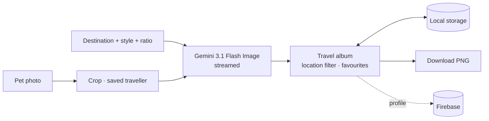

<div align="center">



<p>
  <a href="https://minik-gezgin.vercel.app"></a>
  
  
  
</p>

<p><em>Your pet's passport to anywhere, even Mars. Upload one photo, type a destination,<br>
and Gemini puts your friend there with the place's light, perspective and atmosphere.</em></p>

</div>


## The idea

Pets do not travel much, but their photos can. MinikGezgin (PawPassport in English) keeps a little cast of travellers, your cat, your dog, even a favourite toy, and sends any of them to any place you can name: a landmark, a city at night, a cartoon world or the surface of Mars. Every trip lands in a travel album you can browse, filter and favourite.

> **The traveller stays the same.** Each upload is cropped and saved as a subject, so the same pet goes on every trip. The style and the aspect ratio are chosen per trip, and the image streams back from Gemini as it is made.


## Features

| | |
|---|---|
| **Travellers** | Upload a photo of a pet (a *character*) or an object, crop it, name it and keep it for later trips. |
| **Any destination** | Type a landmark, a scene or a concept; four starter templates (Paris, Tokyo, New York, Venice) help you begin. |
| **Eight styles** | Default, Cinematic, Pixar-like 3D, Vintage Poster, Cyberpunk, Watercolor, Ghibli-like anime and Oil Painting. |
| **Five ratios** | 1:1, 9:16, 16:9, 3:4 and 4:3 in the advanced settings. |
| **Streamed generation** | Gemini 3.1 Flash Image streams the result into the card. |
| **Travel album** | Every trip saved with its location; filter by place, switch to favourites, download or delete. |
| **Saved in the browser** | Travellers and trips persist in local storage. |
| **Profile** | A Firebase-backed profile when an account is present. |
| **TR / EN, light and dark** | Two languages and two themes, with skeleton loaders and toasts. |


## Where it stands

| Piece | State |
|---|---|
| Upload, crop, destination, styles, ratios, generation, album, favourites, download | Working |
| Firebase account | The profile and user document are wired; a sign-in screen is not hooked up yet |
| Sharing | The button says "coming soon" |
| ZIP / PDF album export, AI travel ideas | Planned (the libraries are installed, the screens are not built) |


## How it fits together




## Türkçe özet

**MinikGezgin**, evcil hayvanlarının fotoğraflarını yapay zekâ ile istediğin yere götüren bir seyahat albümü uygulaması. Bir kez fotoğraf yükleyip kırpıyorsun, dostun "yolcu" olarak kaydediliyor; hedefi yazıp sekiz stilden (sinematik, Pixar benzeri, Ghibli benzeri, suluboya…) ve beş en-boy oranından birini seçiyorsun, Gemini sonucu akış hâlinde üretiyor. Her gezi albümde konumuyla saklanıyor; konuma göre filtreleme, favoriler ve indirme var. Paylaşım, ZIP/PDF albüm ve yapay zekâ gezi önerileri sırada.


## Development

```sh
npm install
cp .env.example .env.local   # GEMINI_API_KEY and the VITE_FIREBASE_* values
npm run dev                  # http://localhost:3000
npm run build
npm run lint                 # tsc --noEmit
```

`GEMINI_API_KEY` is injected into the client bundle at build time, so restrict the key to your domain. The six `VITE_FIREBASE_*` values enable the profile.

```
src/App.tsx         travellers, destination form, generation, album
src/components/     style selector, crop modal, album card, profile modal, navigation, toasts
src/translations.ts TR and EN strings
src/lib/firebase.ts Firebase app
```

<div align="center">
<br>
<a href="https://github.com/kutluhangil"></a>
<sub>All rights reserved · the pet and places in the banner are drawn placeholders.</sub>
</div>
