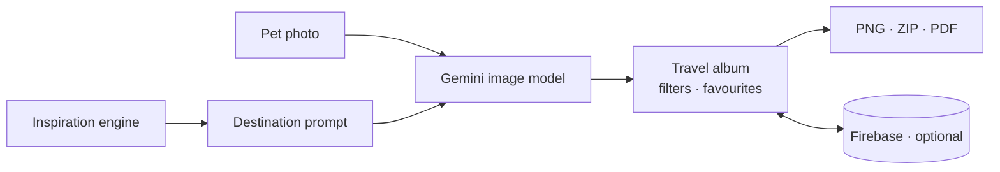

<div align="center">


<p>
  <a href="https://minik-gezgin.vercel.app"></a>
  
  
  
</p>

<p><em>Turn everyday pet photos into photorealistic travel memories.<br>
Machu Picchu, a gondola in Venice or a walk on Mars, without leaving the garden.</em></p>

</div>


## What it is

MinikGezgin (also called PawPassport) is an AI travel album studio. Upload one photo of your pet, type a destination, and Gemini places them there with matching light, perspective and atmosphere. Every result lands in a travel album you can browse, favourite and export.

| | |
|---|---|
| **AI image generation** | Photorealistic composites from a single upload with Gemini's image model. |
| **Any destination** | Type a landmark, a scene or a concept, from the Colosseum to a cyberpunk city. |
| **Inspiration engine** | Travel ideas tailored to your pet's name and style. |
| **Travel album** | An auto-saved gallery with filters, favourites and sorting. |
| **Export** | Download single images, a ZIP of the album or a PDF travel book. |
| **Accounts** | Optional Firebase sign-in to keep albums across devices. |




## Türkçe özet

**MinikGezgin**, evcil hayvanlarının fotoğraflarını yapay zekâ ile dünyanın ikonik mekânlarına yerleştiren bir seyahat albümü uygulaması. Tek bir fotoğraf yükleyip hedefi yazıyorsun; Gemini dostunu o mekâna ışığı ve perspektifiyle birlikte yerleştiriyor. Sonuçlar albümde saklanıyor, tek tek ya da ZIP ve PDF olarak indirilebiliyor.


## Development

```sh
npm install
cp .env.example .env.local   # GEMINI_API_KEY, Firebase config
npm run dev                  # http://localhost:3000
npm run build
```

<div align="center">
<br>
<a href="https://github.com/kutluhangil"></a>
<sub>Every pet deserves a passport.</sub>
</div>
